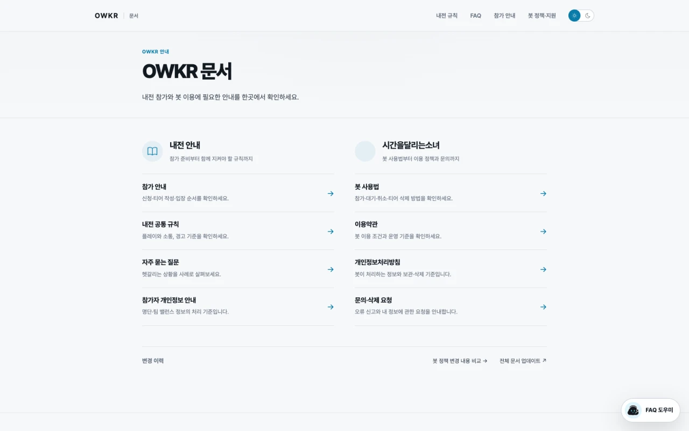

# OWKR 문서

OWKR 내전에 참가하는 방법과 공통 규칙, Discord 모집 봇 **시간을달리는소녀**의 사용 안내를 한곳에서 확인할 수 있습니다.

**[OWKR 문서 열기](https://overwatch-kr.github.io/owkr-docs/) · [Discord 문의](https://discord.gg/overwatchkr)**

## 내전 참가자 안내

- [참가 안내](https://overwatch-kr.github.io/owkr-docs/participation)에서 신청, 티어 작성, 대기실 입장 순서를 확인합니다.
- [내전 공통 규칙](https://overwatch-kr.github.io/owkr-docs/rules)에서 플레이와 소통, 경고 기준을 확인합니다.
- [자주 묻는 질문](https://overwatch-kr.github.io/owkr-docs/faq)에서 참가와 봇 사용 중 자주 겪는 상황을 찾아봅니다.
- [참가자 개인정보 안내](https://overwatch-kr.github.io/owkr-docs/participant-privacy)에서 참가 명단과 팀 편성 정보의 처리 기준을 확인합니다.

## 시간을달리는소녀 이용 안내

[봇 정책·지원](https://overwatch-kr.github.io/owkr-docs/gather-bot)에서 이용약관, 개인정보처리방침, 문의와 삭제 요청 방법을 확인할 수 있습니다.

## 관련 OWKR 서비스

- [OWKR Match](https://github.com/Overwatch-KR/owkr-balance) · 내전 팀 편성
- [OWKR 관리자 시험](https://owkr-exam.vercel.app/) · 내전 운영진 선발 시험
- [시간을달리는소녀](https://github.com/Overwatch-KR/owkr-gather-bot) · Discord 내전 모집
- [OWKR 내전 워크샵](https://github.com/Overwatch-KR/owkr-scrim-workshop) · 사용자 지정 게임 모드 준비 중
